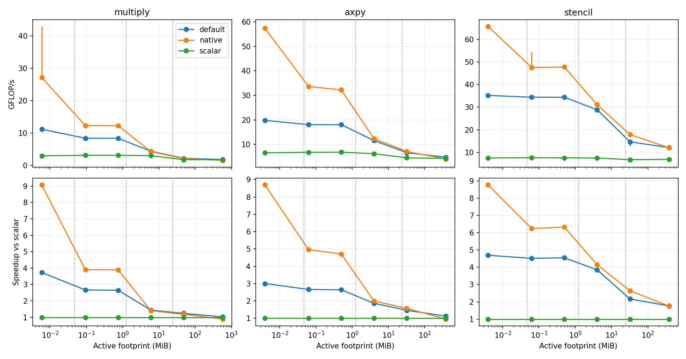
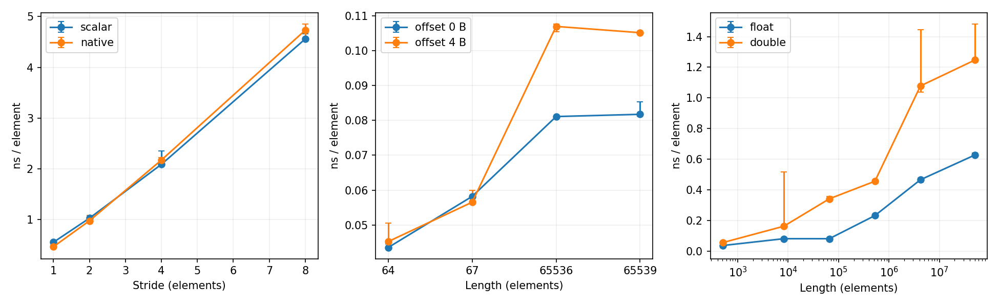

# SIMD speedup across the i7-11800H memory hierarchy

Float32 multiply reached **9.07x scalar speed at a 6 KiB footprint**. At 576 MiB the same native build achieved **0.90x**, even though its unit-stride loop contained a 512-bit packed multiply. The [hypothesis](HYPOTHESIS.md) predicted that cache-resident loops would gain more from vectorization.

Float32 kernel | Speedup, 512 elements | Speedup, 50,331,648 elements | Native large-array GFLOP/s
Multiply       | 9.07x                 | 0.90x                        | 1.59
AXPY           | 8.70x                 | 0.95x                        | 4.07
Three-point stencil | 8.77x            | 1.75x                        | 12.00

The footprint sums active input and output arrays. For float multiply the native speedup was 3.90x at 768 KiB (inside L2), 1.41x at 6 MiB (inside LLC), and 1.19x at 48 MiB (beyond LLC). The stencil reuses adjacent input values and performs five arithmetic operations per output, which gives it more work to accelerate per byte streamed.

## Instruction and timing evidence

GCC 15.2.0 compiled three builds at -O3 with contraction disabled. Scalar used x86-64 with tree vectorization disabled, default allowed SSE vectorization, and native used -march=native with a 512-bit preference. Multiply progresses from scalar mulss to packed mulps and then vmulps with a ZMM operand. The native binary also contains a YMM remainder and scalar instructions. A ZMM holds 16 floats or 8 doubles. AXPY emits separate multiply and add instructions. The stride branch takes scalar operations. See [instructions](raw/instructions.txt) and [build flags](build.sh).

The native Ubuntu 26.04.1 run used CPU 0 of an 8-core, 16-thread Core i7-11800H, kernel 7.0.0-30-generic, SMT enabled, powersave governor, and no documented CPU isolation. (From CPUID) we have 48 KiB L1D, 1.25 MiB L2 and 24 MiB LLC. Initialization and checks occur outside timing. Inputs use periodic, exactly representable fractions. One warm-up checks up to 1,001 outputs including endpoints against NumPy and checks untouched stride positions. A monotonic raw clock times repeated calls with a nominal 12 ms target, at least one pass. Three shuffled trials use fresh buffers. Figures show medians and throughput ranges; speedups divide median scalar time by median build time. RDTSCP supplies reference ticks per element in the CSV. Turbo frequency can vary during a trial.

## Alignment, tails, stride and precision

At 65,536 floats, shifting the aligned base pointers by four bytes raised the native median from 0.081 to 0.107 ns/element, about 32%. Keeping alignment and adding three tail elements raised it only to 0.082. At 64 versus 67 elements the cost rose from 0.044 to 0.058 ns/element. A fixed remainder and per-call overhead matter more in a short loop. These are whole-loop timings.

At 4,194,304 outputs, strides 1, 2, 4 and 8 delivered 23.99, 11.45, 5.14 and 2.36 useful GiB/s. Speedup fell from 1.19x to 0.96x. Increasing stride changes both the compiler path and the occupied range, and each fetched line contributes fewer results. At 512 elements native multiply took 0.037 ns/float versus 0.056 ns/double. At the largest size it took 0.627 versus 1.247. Doubling element size halves lane count and doubles useful traffic for a fixed number of products.

## Roofline check

A float product uses two four-byte inputs and one four-byte output, giving 1/12 FLOP per useful byte. The separately timed, beyond-LLC copy achieved 16.66 useful GiB/s. That projects **1.49 GFLOP/s** for multiply, close to the measured **1.59 GFLOP/s**. Differences in write allocation and stream count make the copy rate approximate. An illustrative one-core compute estimate assumes one 16-lane multiply each cycle at the nominal 2.30 GHz, or 36.8 GFLOP/s. This is an execution-rate assumption, the active AVX clock and sustained issue rate were unmeasured. The large-array result is much closer to the bandwidth estimate. The 0.90x speedup shows why verifying vector instructions alone cannot establish a performance gain.
