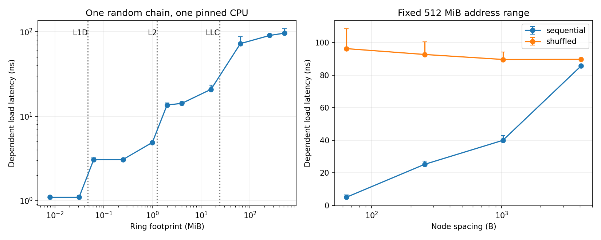
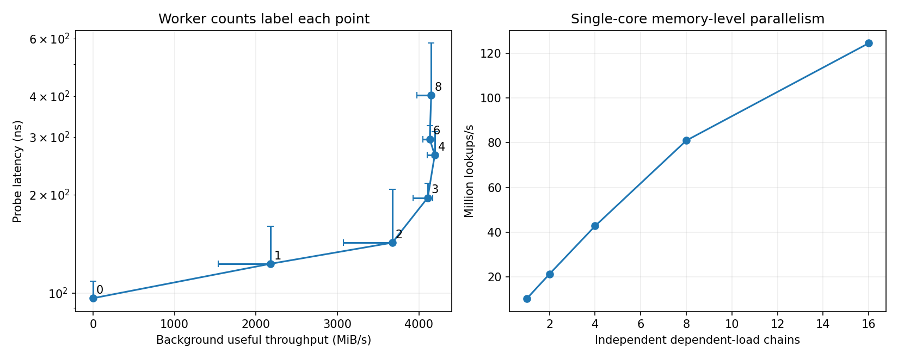
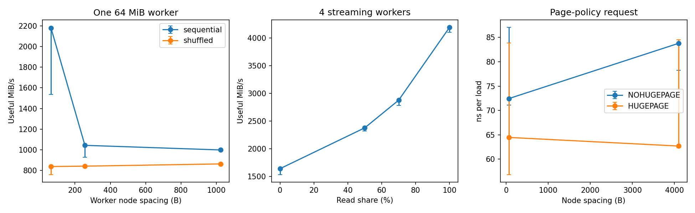

# Cache latency, translation and memory contention on the i7-11800H

An unloaded random dependent load took **1.09 ns in an 8 KiB ring** and **96.36 ns in a 512 MiB ring**. At that same large footprint, sequential line traversal took just **4.96 ns**. Using this sequential result as a random DRAM latency estimate would understate the measured cost by about 19x.

Representative ring | Intended regime       | Median ns/load | Three-trial range, ns
8 KiB               | L1D, capacity 48 KiB  | 1.09           | 1.09–1.10
256 KiB             | L2, capacity 1.25 MiB | 3.07           | 3.06–3.17
4 MiB               | LLC, capacity 24 MiB  | 14.18          | 13.86–14.45
512 MiB             | Beyond LLC            | 96.36          | 96.05–108.57

## Measurement and access pattern

The [hypothesis](HYPOTHESIS.md) preceded timing. CPU 0 traversed a cycle of four-byte offsets, with each load supplying the next address. Each shuffled ring was checked for a single full-length cycle before timing. Three seeds and randomized case order were used. Trial duration was at least 80 ms. Zero workers means zero intentionally added traffic. MiB refers to address range, and per-level latency includes translation and loop costs. At 512 MiB, sequential 64/256/1,024-byte spacing took 4.96/25.21/39.95 ns, versus 96.36/92.77/89.70 ns shuffled. Prefetch and fewer active cache lines at larger spacing change the effective workload.

A simple AMAT illustration using the measured endpoints gives 0.99 x 1.09 + 0.01 x 96.36 = 2.04 ns. The assumed 1% long-latency fraction illustrates sensitivity to misses; it was not measured on the ring.

Ubuntu 26.04.1 ran kernel 7.0.0-30-generic and GCC 15.2.0 on an 8-core/16-thread CPU with about 30.5 GiB RAM. SMT was on and the governor was powersave. Probe and worker threads were pinned to distinct logical CPUs and first-touched their own memory. Physical-core isolation and memory-controller traffic were unmeasured. All intervals in the plots span three trials.

## Where load stops helping

Three read workers delivered 4,108 useful MiB/s with 196 ns probe latency. Four delivered 4,194 MiB/s at 264 ns; eight delivered 4,150 MiB/s at 402 ns. Three workers are a practical knee, already within 3% of the highest median throughput. The small throughput gain from three to four cost 35% more probe latency. Background throughput counts eight useful bytes per operation and excludes index, line-fill and writeback traffic.

A separate single-core experiment interleaved independent chains. Going from one to 16 raised completions from 10.38 to 124.39 million/s. Little’s Law for the software chains gives 16 / 124.39M ~= 129 ns per chain recurrence, while the aggregate completion interval is only 8.04 ns. Hardware miss occupancy was unmeasured. The loaded-latency plot measures two different populations, so its worker byte rate and probe latency cannot directly yield controller queue depth.

With one worker, sequential 64/256/1,024-byte spacing supplied 2,180/1,043/999 useful MiB/s versus 838/842/863 shuffled. Workers each traverse a private 64 MiB range through an index array. With four workers at 100/70/50/0% reads, throughput was 4,194/2,878/2,378/1,640 MiB/s and the dependent read probe took 264/317/387/443 ns. Worker completion accounting includes the last 1,000-operation batch at shutdown.

## Hardware counters and page locality

The separate elementwise multiply experiment validated every output and untouched slot and captured all four user-mode PMU events in all 15 trials. The table gives medians of per-trial counts divided by products completed. The original ring trials received errno 13 on the cache-event probe; these counts apply specifically to multiply.

Active arrays and stride | ns/product | Cycles/product | Instructions/product | Cache misses/product | dTLB read misses/product
12 KiB, unit             | 0.107      | 0.49           | 0.87                 | <0.00001             | <0.00001
3 MiB, unit              | 0.273      | 1.24           | 0.75                 | 0.0187               | <0.00001
576 MiB, unit            | 0.574      | 2.62           | 0.75                 | 0.114                | 0.00028
576 MiB, stride 16       | 10.137     | 46.34          | 6.00                 | 2.154                | 0.00391
576 MiB, stride 1,024    | 26.598     | 120.73         | 6.00                 | 3.054                | 2.001

At fixed 576 MiB, moving from one product per cache line to one per 4 KiB page left instructions/product near six but more than doubled cycles/product. The concurrent jump in translation events supports a page-locality cost. Each product touches multiple arrays, so events/product can exceed one. Cache misses also rose, and the counters cannot assign every extra cycle to translation.

For the separate 64 MiB random ring with one node per 4 KiB, requesting huge pages lowered the median from 83.78 to 62.69 ns. The recorded anonymous huge-page backing changed from zero to 65,536 KiB. The three-trial ranges overlapped (78.22–84.50 and 62.34–84.50 ns), so the size of the benefit is uncertain. Holding ring spacing fixed controls the number of active data lines for this comparison.
