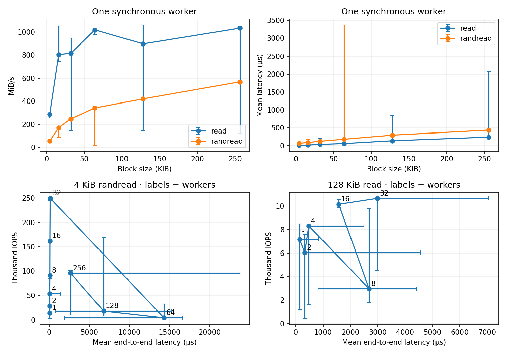
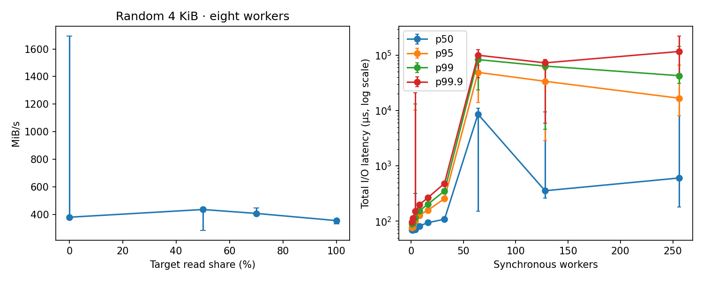

# Storage concurrency on a Corsair MP400 NVMe SSD

The fastest tested random 4 KiB read configuration was **32 synchronous workers at 249,648 IOPS**, with **128 us mean latency** and **350 us p99 latency**. Three trials at 32 workers stayed between 244,684 and 249,771 IOPS. Higher worker counts produced much lower and more variable results. The measurements establish a useful operating point on this machine; the extension cannot establish a universal controller saturation depth.

## Target and method

I used an ext4 disposable file on /dev/nvme0n1p3, a dedicated 9.3 GiB partition of the 1.8 TiB Corsair MP400. Ubuntu root was on a different partition of the same drive, so ordinary OS activity could share the device. fio 3.41 first filled 512 MiB with random bytes, fsynced, and verified 4 MiB with CRC32C. All main tests used direct file I/O. fio refilled write buffers with a requested compressibility of 0%. Writes timed completion without a per-operation durability flush. The [hypothesis](HYPOTHESIS.md) predicted rising throughput followed by a queueing knee.

Linux 7.0.0-30-generic ran on the Core i7-11800H with SMT enabled and the powersave governor. fio used psync, depth one per thread, split affinity over 16 logical CPUs, and disjoint file slices. Worker count controls aggregate concurrency. Three two-second repetitions per condition ran in shuffled order. The 64–256-worker extension used a second freshly initialized file and separate randomized order. Median throughput, I/O-count-weighted mean total latency per trial, and directional latency percentiles are retained. Error bars show observed ranges. Raw JSON records zero fio errors and short I/Os across the trials.

## Depth-one baselines

Pattern                  | IOPS   | MiB/s | Mean us | p50 us | p95 us | p99 us | p99.9 us
Random 4 KiB read        | 14,335 | 56.0  | 69.50   | 69.12  | 76.29  | 88.58  | 96.77
Random 4 KiB write       | 81,182 | 317.1 | 11.50   | 11.20  | 12.48  | 21.63  | 30.59
Sequential 128 KiB read  | 7,176  | 897.0 | 138.99  | 105.98 | 220.16 | 296.96 | 514.05
Sequential 128 KiB write | 2,688  | 336.0 | 340.41  | 337.92 | 358.40 | 407.55 | 987.14

At depth one, random reads grew from 56 to 569 MiB/s as block size rose from 4 to 256 KiB, while mean latency increased from 69.5 to 438.6 us. Sequential reads reached 1,018 MiB/s at 64 KiB, dipped to 897 at 128 KiB and reached 1,033 at 256 KiB. Larger blocks amortize request overhead, but successive sizes did not always improve observed throughput. The highest tested sequential median was **1,334 MiB/s** at 128 KiB and 32 workers. The test records NVMe transport but no negotiated link width or speed, so a PCIe bandwidth ceiling cannot be inferred.

At eight workers and random 4 KiB blocks, the 100/70/50/0% read mixes achieved 355/407/435/379 MiB/s with respective mean latencies of 87.75/76.18/67.83/81.46 us. The achieved mixed read shares were 69.97% and 50.03%. Faster small-write acknowledgments at low concurrency and short file reuse could contribute to the mixed results. These runs do not establish a long-duration write rate.

## The unstable high-concurrency extension

Workers, random 4 KiB reads | Median IOPS | Mean us | p50 us | p95 us | p99 us | p99.9 us
8                           | 90,769      | 87.75   | 81     | 127    | 153    | 198
32                          | 249,648     | 127.76  | 108    | 255    | 350    | 481
64                          | 4,346       | 14,293  | 8,585  | 49,021 | 83,362 | 100,139
128                         | 18,295      | 6,768   | 354    | 33,817 | 63,701 | 72,876
256                         | 95,645      | 2,667   | 602    | 16,712 | 42,729 | 116,916

32 workers are the first tested configuration reaching 95% of the highest median. Little’s Law gives 249,648/s x 127.76 us ~= 31.9 application requests in flight. fio still reports depth one per synchronous worker. The raw 128-worker trials reached **18,295, 8,247 and 168,995 IOPS**. At 64 workers even the fastest repetition reached only 32,216 IOPS. A short run, oversubscribed workers, shrinking per-worker range and drive state after prefill all complicate attribution. The 64-worker medians show a 100 ms p99.9, more than 200 times the 32-worker value. Treating the curve as a smooth device-internal saturation response would hide this evidence.

## File range, caching and state

Restricting random reads at one worker to 16 MiB gave 14,464 direct IOPS versus 14,335 over 512 MiB. The 16 MiB buffered variant returned 14,428 IOPS. fio requested cache invalidation at startup, and the buffered logs still show device reads. A small working set and a buffered flag alone did not demonstrate a warm page-cache speedup. SSD temperature, SMART state, negotiated link rate, SLC-cache occupancy and a sustained write plateau were not recorded. The experiment therefore characterizes short-run file I/O on this configuration.
